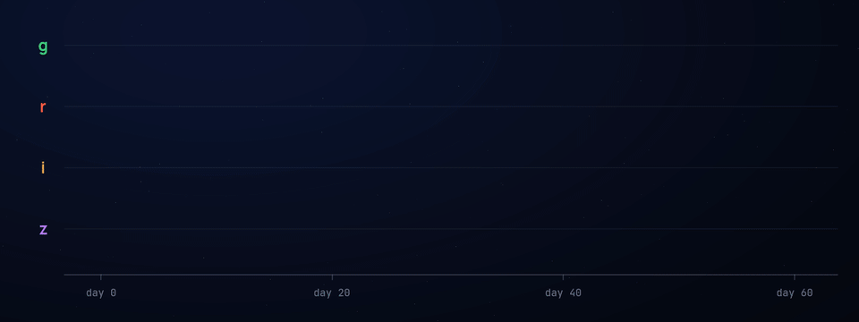

# OASIS — on-the-fly classification of asynchronous image streams

[](LICENSE)

<p align="center">
  
</p>
<p align="center"><sub>Images arrive one at a time, one colour band each, at irregular times; OASIS attends from each new image back to the earlier ones and updates its prediction. Simulated survey images.
<a href="https://deltasata.github.io/oasis/">Interactive explorer ↗</a></sub></p>

**In short:** deep-learning models that classify a stream of images while it arrives: every new
frame (any of four colour bands, at irregular times) updates the prediction. Seven transformer
designs are compared on the same data: factorized vs joint space-time attention, windowed and
pyramid variants and a Perceiver-style readout, with Time2Vec time embeddings and causal masking,
evaluated at the real 8.5% positive rate. Application: finding rare gravitationally lensed
supernovae in the Rubin/LSST survey.

Code for:

> **OASIS: On-the-fly ASynchronous Image Stream classification**

Seven transformer architectures that score each new observation of a multi-band,
irregularly sampled image time series as a lensed SN Ia or not. Inputs are the
image of the band that arrived, its observation time, and its band index.

## Data

The paper trains on 128 000 systems. `Transformer_demo4096/` ships a small subset
so the models run end to end.

| file | shape | contents |
|------|-------|----------|
| `<split>_imgs.npy` | `(N, 14, 1, 26, 26)` | one image per epoch, `float16` |
| `<split>_time.npy` | `(N, 14)` | normalised observation time per epoch |
| `<split>_band.npy` | `(N, 14)` | band index per epoch (0=*g*, 1=*r*, 2=*i*, 3=*z*) |
| `<split>_labels.npy` | `(N,)` | binary label |
| `label_and_details_<Split>.txt` | `(N, 2)` | class code, catalogue ID |
| `idxs_<Split>.npy` | `(N,)` | indices into the full dataset |

`<split>` is `train` / `val` / `test`.

| split | N | positive | negative |
|-------|---|----------|----------|
| train | 4096 | 2048 | 2048 |
| val | 1024 | 88 | 936 |
| test | 1024 | 84 | 940 |

Class codes `2` and `4` are positive, `0`, `-21`, `-22`, `-31` negative. The
class ratio of each split follows the full dataset: training balanced,
validation and test at the real ~8.5% positive rate. Images are the central
26×26 of the 59×59 stamps, to stay under GitHub's file limit.

## Models

`models/` holds one self-contained script per architecture. They share the same
dataset, training loop and hyperparameters, and differ only in the model.

| | attention over space and time | readout | width, depth |
|---|---|---|---|
| `A1-factorized_mean_pool.py` | factorized | mean pool | 256, 4 |
| `A2-factorized_query_readout.py` | factorized | learned query | 256, 4 |
| `A3-factorized_latent_array.py` | factorized | latent array | 256, 4 |
| `B1-joint_global.py` | joint, global | mean pool | 256, 4 |
| `B2w-joint_window_wide.py` | joint, 3×3 window | mean pool | 384, 4 |
| `B2d-joint_window_deep.py` | joint, 3×3 window | mean pool | 256, 6 |
| `B3-joint_pyramid.py` | joint, pyramid | time-conditioned | 256, 3+3 |

## Model search behind the seven designs

The seven architectures were chosen from a larger search on the full dataset (PyTorch, AMD GPUs, Slurm):

| | |
|---|---|
| training runs | 227 |
| distinct configurations | 100 |
| architecture families | 19 |
| component studies on frozen backbones | band embedding, CNN stem, time embedding (10 variants) |
| seeds per published architecture | 11 |

What the search showed:

- Factorized space–time attention beats joint attention by about four times the seed-to-seed
  noise, at the same compute: an inductive-bias effect, not a capacity effect.
- Joint attention only works with a restricted spatial reach (3×3 window); global joint
  attention dilutes over 1,134 tokens.
- The causal Perceiver-style readout is the most effective single change for factorized models.
- The factorized models are capacity-saturated: a 1.1M-parameter model matches a 4.3M one.
- Negative results: MLP-Mixer and state-space (Mamba/S4-style) spatial mixers,
  mixture-of-experts feed-forward layers, a learned relative position bias, recurrent-latent
  bottlenecks and explicit cross-band fusion all did worse.
- Several single-seed records regressed on reseeding, so each of the seven published
  architectures was trained on 10+ seeds (11 each), and every conclusion rests on more than one backbone.

## Running it

```bash
python models/A2-factorized_query_readout.py
```

Everything you need to change is in the **CONFIG** block at the top. It ends
with a demo block:

```python
DEMO_MODE = True     # small demo set
```

Set `DEMO_MODE = False`, or delete the block, to train on the full dataset with
the published settings, and point `DATA_DIR` at your own data. Nothing outside
that block refers to the demo.

Training writes to `models/runs/<MODEL_ID>/`, keeps the best model by `val_loss`
and rolls back after `NHOLD` bad epochs.

**This is a smoke test, not a reproduction.**

## License

MIT, see [LICENSE](LICENSE).
